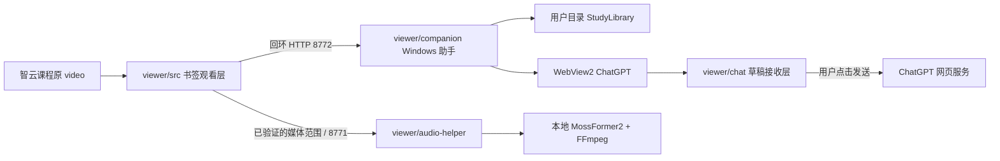

# 项目地图：功能、数据流与每个文件

这份地图覆盖公开 Git 树中的每个文件。使用步骤在 [README](../README.md)，不可破坏的产品语义在 [AGENTS](../AGENTS.md)，数据格式与恢复规则在 [STORAGE](../viewer/STORAGE.md)。新增、重命名或改变职责时同步更新这里；生成文件与本机资料另列，不能把它们当源码修改。

## 先理解四个运行部分

`viewer/build.py` 从 `src/focus.js` 和 `chat/draft-receiver.js` 两个入口打包相对 ES module 依赖。观看脚本进入书签；接收脚本作为 `ZjfChatDraft.js` 资源嵌入原生 EXE，由 WebView2 在 ChatGPT 页面加载。课程和 ChatGPT 是两个页面环境，不能假定共享 DOM、localStorage 或同一轮用户意图。

声音模型代码、权重和 Python 环境从公开固定来源安装到 `.runtime/audio`。它们不编译进 EXE，也不上传课堂音频。没有 GPU 模型不影响基础原视频观看。

## 按任务找入口

| 想改什么 | 先读 | 同时核对 |
| --- | --- | --- |
| 激活书签、选择视频、替换旧实例 | `src/focus.js` | `viewer-ui.js` 的挂载/关闭及 `view-state.js`。 |
| 板位、等比显示、缩放拖动、临时全景 | `src/viewer-ui.js`、`geometry.js`、`layouts.js` | 原媒体身份、`view-state.js`、历史恢复和输入法快捷键。 |
| 工具栏、浮层、侧栏尺寸和动效 | `src/viewer-ui.js`、两份 style 文件 | `controls.js`、`sidebar-layout.js`、原生窗口与实际渲染。 |
| 截图、原始帧、冻结时刻 | `src/capture.js`、`source-frame.js`、`capture-viewport.js` | `viewer-ui.js` 采集事务、`BrowserCaptureViewport.cs`、媒体服务 `/frame`。 |
| 原图保存、待办和重复提交 | `src/capture-outbox.js`、`capture-delivery.js` | `StudyLibrary.cs`、`ChatDraftBridge.cs`、STORAGE。 |
| 图片流、选择、历史定位 | `src/study-library-ui.js`、`library-selection.js`、`library-restore.js` | `study-context.js`、`StudyLibrary.cs` 的版本/来源证据。 |
| 问题文字、引用、移图/撤销 | `chat/draft-receiver.js`、`draft-model.js`、`inline-draft.js` | `attachment-ui.js`、实际 ChatGPT 编辑器/附件、原文与选区。 |
| 同课下一问、换对话、发送证据 | `chat/conversation-state.js`、`draft-receiver.js` | `ChatDraftBridge.cs`、`WebViewChat.cs`、持久回执。 |
| 保护、焦点、全屏与迟到回执 | `src/study-interaction.js`、`input-guard.js`、`fullscreen.js` | `intent-scopes.js`、`protection-door.js`、`StudyCompanion.cs`。 |
| 声音生命周期、seek、倍速、降噪 | `src/clarity.js`、`audio-manager.js` | `voice-startup.js`、音频 `launcher.py` / `server.py` / `mossformer.py`。 |
| 安装、启动、系统注册 | `companion/StudyCompanion.cs`、`SystemRegistration.cs` | `build.ps1`、manifest、`UserDataStore.cs`；不以源码版本代替进程核对。 |
| 存储迁移、原子写入、备份 | `companion/UserDataStore.cs`、`StudyLibrary.cs` | STORAGE；不能将读取失败解释成空库。 |

下面所有 `src/...`、`chat/...`、`companion/...` 和 `audio-helper/...` 都相对仓库中的 `viewer/`。

## 根目录、文档与许可

| 文件 | 作用 / 如何使用 |
| --- | --- |
| [README.md](../README.md) | 用户入口：功能、平台边界、从源码安装、看课流程、数据位置、更新/退出及排错。 |
| [AGENTS.md](../AGENTS.md) | 全仓库维护约定与完整产品定义。Agent 在实施前读取，保留使用者最新意图和已接受行为。 |
| [docs/PROJECT_MAP.md](PROJECT_MAP.md) | 本文件。逐文件职责、功能定位与跨层数据流。 |
| [LICENSE](../LICENSE) | 项目原创部分的 MIT 许可。 |
| [THIRD_PARTY_NOTICES.md](../THIRD_PARTY_NOTICES.md) | 第三方来源、固定版本、许可范围及未随仓库分发的运行环境。 |
| [LICENSES/Apache-2.0.txt](../LICENSES/Apache-2.0.txt) | MossFormer2 适配与作者代码相关 Apache-2.0 原文。 |
| [LICENSES/WebView2.LICENSE.txt](../LICENSES/WebView2.LICENSE.txt) | WebView2 SDK 包中的原始许可；原生构建复制到 DLL 同目录。 |
| [LICENSES/WebView2.NOTICE.txt](../LICENSES/WebView2.NOTICE.txt) | WebView2 SDK 原始第三方 notices；随组件构建保留。 |
| [.gitignore](../.gitignore) | 公开文件白名单及私有/生成资产排除规则。新增文件先决定是否应公开，再更新白名单。 |
| [.gitattributes](../.gitattributes) | 固定源码与 Windows 脚本的换行规则，避免跨系统检出造成不必要差异。 |
| [启用清晰人声.cmd](../启用清晰人声.cmd) | 双击调用 Python 声音启动器；从脚本所在目录定位仓库，保留退出码。 |
| [停止清晰人声.cmd](../停止清晰人声.cmd) | 双击请求本项目声音服务正常停止；不依据 PID 强杀进程。 |

## 构建与数据协议

| 文件 | 作用 / 主要入口 |
| --- | --- |
| [viewer/package.json](../viewer/package.json) | 应用版本和 ES module 类型声明。`private: true` 防止误发 npm 包，不影响 GitHub 开源；没有 npm 依赖。 |
| [viewer/build.py](../viewer/build.py) | Python 标准库构建器。解析本地 import、拒绝循环/越界依赖、打包两个入口、生成书签/HTML/摘要；`--check` 验证现有产物，`--output-dir` 和 `--entry-path` 指定隔离输出。 |
| [viewer/serve.py](../viewer/serve.py) | 可选回环开发预览，默认 8769，只服务 `viewer/dist`；视频文件支持 byte range、响应不缓存。不代理课程，不读历史音频目录。 |
| [viewer/STORAGE.md](../viewer/STORAGE.md) | 原图、快照、草稿、选择、交付回执、备份、迁移、恢复及协议身份的详细契约。修改任意存储字段时先读。 |

## 观看层：viewer/src

| 文件 | 职责与关键入口 |
| --- | --- |
| [focus.js](../viewer/src/focus.js) | `activateFocus`：校验域名/视频可见性、选择原视频、替换旧观看器、保存并恢复宿主页属性，建立挂载容器。 |
| [viewer-ui.js](../viewer/src/viewer-ui.js) | `mountViewer`：观看器集成入口，组织播放、板位、采集、图片预览、资料与聊天、快捷键、异步意图和关闭交接。先找相关子模块，不把所有逻辑继续堆在此处。 |
| [start.html](../viewer/src/start.html) | 本地安装入口的 HTML 模板；构建器替换 `__BOOKMARK__`，提供书签拖入/复制、助手启动和使用说明。 |
| [geometry.js](../viewer/src/geometry.js) | 归一化区域、等比适配、屏幕到源坐标映射、框选、拖动和锚点缩放；不操作 DOM 或媒体时钟。 |
| [view-state.js](../viewer/src/view-state.js) | 媒体/视角恢复判断、比例校验、遮挡图片判断及资源比较；尺寸相同不是同源证据。 |
| [layouts.js](../viewer/src/layouts.js) | 最多六个板位的清洗、讲次键、布局匹配与存储仓库；存储失败有内存退路。 |
| [controls.js](../viewer/src/controls.js) | 工具栏保持条件、鼠标/触摸/触笔意图、可编辑目标与观看快捷键许可；避免截获 IME 和浏览器组合键。 |
| [player-style.js](../viewer/src/player-style.js) | `PLAYER_CSS`：观看控制区、板位/设置浮层、保护入口等视觉与动效。改后检查集成页面。 |
| [workspace-style.js](../viewer/src/workspace-style.js) | `WORKSPACE_CSS`：侧栏、资料和原图工作区布局/状态样式；与原生侧栏尺寸共同生效。 |
| [toolbar-icons.js](../viewer/src/toolbar-icons.js) | 观看/资料操作的 SVG 图标和归一化板位小地图，保持统一视觉语言。 |
| [sidebar-layout.js](../viewer/src/sidebar-layout.js) | 侧栏宽度边界、偏好清洗、拖动节流和最终位置提交；调整宽度不重新打开窗口。 |
| [companion.js](../viewer/src/companion.js) | `createStudyCompanion`：8772 客户端、握手/功能协商、课程窗口绑定、鉴权请求、捕获验证、资料/草稿/保护命令与有限重连。 |
| [course-window-binding.js](../viewer/src/course-window-binding.js) | 课程页面与原生窗口的临时唯一标记/标题绑定，结束时清理，只用于关联当前窗口。 |
| [immersive-session.js](../viewer/src/immersive-session.js) | 原生组件准备与会话开始的协调；保留取消和最新操作意图，不将连接成功等同于打开聊天。 |
| [intent-scopes.js](../viewer/src/intent-scopes.js) | `createIntentScopes`：各操作的代际、取消、所有权及 await 后检查；旧完成不能覆盖新选择。 |
| [study-interaction.js](../viewer/src/study-interaction.js) | 输入/工作区动作协调与保护开关串行收敛，确保最新关闭意图在迟到开启后仍生效。 |
| [input-guard.js](../viewer/src/input-guard.js) | 页面侧写字保护、触摸/触笔判别、允许交互区域和可用视口计算；保护不从历史偏好自动重开。 |
| [protection-door.js](../viewer/src/protection-door.js) | 鼠标/触笔/键盘保护退出入口，长按和滑动过程、可中断动效及失焦清理。 |
| [fullscreen.js](../viewer/src/fullscreen.js) | 实际 DOM/原生全屏确认、进入/退出意图、失败和迟到请求清理；区别全屏与页面铺满。 |
| [audio-manager.js](../viewer/src/audio-manager.js) | 观看器声音偏好与 `createClarityAudio` 的集成，切换原声/增强与销毁时恢复。 |
| [clarity.js](../viewer/src/clarity.js) | 本地增强的浏览器音频调度：媒体访问探针、窗口请求/预取、原声所有权、seek/倍速同步、失效和有界恢复。 |
| [voice-startup.js](../viewer/src/voice-startup.js) | 媒体服务启动/health 确认、总时间预算与取消；启动响应不等于模型已就绪。 |
| [capture.js](../viewer/src/capture.js) | 原图容量合同、冻结采集时钟、Canvas/图片帧、同帧板位裁切、选区与剪贴板复制；保留像素和来源。 |
| [capture-viewport.js](../viewer/src/capture-viewport.js) | 将 CSS/visual viewport/DPR 映射到实际内容区域，验证原生截图前后几何与尺寸，拒绝猜测浏览器边框。 |
| [source-frame.js](../viewer/src/source-frame.js) | 媒体身份摘要和 `/frame` 客户端；验证来源可访问性、实际帧时刻、索引和原像素合同，不 seek 原视频。 |
| [image-data.js](../viewer/src/image-data.js) | 在内存解析本地图片 data URL 为 Blob，避免把本地图片当作远程 fetch 或触发宿主页 CSP。 |
| [capture-course.js](../viewer/src/capture-course.js) | 从当前课程 DOM 提取课程名、教师等显示信息；这些文本不是媒体身份。 |
| [study-context.js](../viewer/src/study-context.js) | 规范课程/讲次作用域和显示名称，在观看器及 ChatGPT 接收层共用。 |
| [capture-delivery.js](../viewer/src/capture-delivery.js) | 正式交付目标、操作与回执清洗/匹配；目标变化只允许读证据，不把旧任务重投新问题。 |
| [capture-outbox.js](../viewer/src/capture-outbox.js) | 浏览器待办与 IndexedDB 原像素保护、恢复、持久回执和有界像素缓存；原生确认前不能丢未落盘材料。 |
| [moment-shelf.js](../viewer/src/moment-shelf.js) | 新截图附近的临时缩略图选择、复制/预览/提问/移出/撤销；与长期原图资料分开。 |
| [study-library-ui.js](../viewer/src/study-library-ui.js) | 课堂图片流、课程/讲次选择、历史材料预览、多图选择、旧稿复用、待办与备份入口；只明确定位时才调用恢复视频。 |
| [library-selection.js](../viewer/src/library-selection.js) | 本次素材选择持久化、写入身份/版本、跨窗口三方合并、清空/改序及未确认写入日志。 |
| [library-restore.js](../viewer/src/library-restore.js) | `resolveLibraryRestore`：校验讲次、真实媒体及原图关系，决定历史时刻和完整选区/板位视角；纯计算，不直接 seek。 |
| [chat-sidebar.js](../viewer/src/chat-sidebar.js) | 保留的独立侧栏开启协调函数 `openChatSidebar`；当前 `focus.js` 依赖树未导入，默认侧栏流程在 `viewer-ui.js`。不能把它当现行唯一入口。 |
| [study-actions.js](../viewer/src/study-actions.js) | 保留的动作/错误/重试所有权模型 `createStudyActions`；当前默认入口未导入。开源整理未对这类既有模块作无关删除。 |

## ChatGPT 草稿层：viewer/chat

| 文件 | 职责与关键入口 |
| --- | --- |
| [draft-receiver.js](../viewer/chat/draft-receiver.js) | `installDraftReceiver`：仅安装在 ChatGPT 顶层页；接收桥消息，核对逻辑问题与编辑器代际，附图、编辑、保存、恢复和观察发送证据。不调用私有 ChatGPT API，也不代点发送。 |
| [conversation-state.js](../viewer/chat/conversation-state.js) | 会话规范路由、临时/正式对话身份、桥绑定、发送意图及证据状态；URL 相同不代表同一业务问题。 |
| [draft-model.js](../viewer/chat/draft-model.js) | 材料与逻辑区域、背景去重、旧问题复用、图号映射、移出/撤销/改序及原文合并；合成附件仍保留逻辑材料身份。 |
| [inline-draft.js](../viewer/chat/inline-draft.js) | 单份原生问题正文、光标处引用、用户编辑与来源尾注分界、段落移除/恢复/移动；不另建表单输入框。 |
| [attachment-ui.js](../viewer/chat/attachment-ui.js) | 为本工具附件提供轻量原图预览和就地引用/移出/撤销等操作；尊重用户手动添加的外来附件。 |
| [draft-style.js](../viewer/chat/draft-style.js) | 草稿关联控件、紧凑缩略图和预览的样式；与 ChatGPT 原生编辑器实际布局一起核验。 |
| [draft-icons.js](../viewer/chat/draft-icons.js) | 草稿/附件区域 SVG 图标。 |

## Windows 层：viewer/companion

| 文件 | 职责与关键入口 |
| --- | --- |
| [StudyCompanion.cs](../viewer/companion/StudyCompanion.cs) | 程序入口、CLI 参数、托盘、单实例、8772 HTTP/鉴权/命令、课程会话、保护/全屏/截图、正常退出/升级、构建身份及系统注册协调。 |
| [SystemRegistration.cs](../viewer/companion/SystemRegistration.cs) | 用当前 SID 和 `StdRegProv` 读写真实用户注册项；读回验证、恢复原值、仅清理空键，避免宿主注册表虚拟化。 |
| [EmbeddedChat.cs](../viewer/companion/EmbeddedChat.cs) | 课程窗口内的子窗口宿主、边界/可见性/侧栏几何、输入覆盖和焦点；与 WebView2 渲染职责分开。 |
| [WebViewChat.cs](../viewer/companion/WebViewChat.cs) | WebView2 runtime、profile、controller、导航、焦点、脚本注入、草稿关闭冻结与生命周期管理。 |
| [ChatDraftBridge.cs](../viewer/companion/ChatDraftBridge.cs) | 原生与 ChatGPT 接收脚本的协议桥、目标挑战/绑定、附图尝试、文档代际、回执核验、逻辑问题及恢复调度。 |
| [StudyLibrary.cs](../viewer/companion/StudyLibrary.cs) | 原图/快照/标记/问题/选择/发送记录/交付记录的持久化，摘要校验、原子写入/备份、索引重建、合成材料、导出及来源证明。 |
| [UserDataStore.cs](../viewer/companion/UserDataStore.cs) | 用户独立数据根目录和首次旧数据迁移；复制与逐文件验证，不删除旧资料，不以空目录掩盖失败。 |
| [BrowserCaptureViewport.cs](../viewer/companion/BrowserCaptureViewport.cs) | 从真实浏览器 HWND、MSAA/UIA 证明课程内容位置；绘制标记、DPI/几何、遮挡和采集前后稳定性核对。 |
| [ViewportResolverCache.cs](../viewer/companion/ViewportResolverCache.cs) | 单一有界后台 UIA 查询通道与短时结果；一个 provider 卡住不会不断增开线程。 |
| [build.ps1](../viewer/companion/build.ps1) | 标准原生构建、内嵌资源/运行时检查、SHA-256 manifest、整套产物提交及失败回滚；使用 UTF-8 BOM。 |
| [stop.ps1](../viewer/companion/stop.ps1) | 正常退出命令：握手取得当前令牌、请求保存/排空/关闭并检查回复，失败时不强杀。 |
| [fetch_sdk.py](../viewer/companion/fetch_sdk.py) | 从官方 NuGet 恢复固定 SDK DLL，包/成员摘要校验、原子提交；`--check` 校验当前文件。 |
| [webview2.lock.json](../viewer/companion/webview2.lock.json) | SDK 版本、包 URL/大小/摘要、两个 DLL 在包内的路径与摘要。 |
| [README.md](../viewer/companion/README.md) | 组件构建产物、CLI、注册/升级、状态、退出、资料与跨层契约说明。 |

## 媒体层：viewer/audio-helper

| 文件 | 职责与关键入口 |
| --- | --- |
| [server.py](../viewer/audio-helper/server.py) | 8771 HTTP 服务：来源校验、模型后台初始化、音频范围处理、原始帧索引/解码、限流、取消与本实例关闭。 |
| [launcher.py](../viewer/audio-helper/launcher.py) | 正常启动/停止入口，进程间锁、旧 build 正常接替、实例 ID 校验、虚拟环境选择与启动日志。 |
| [runtime.py](../viewer/audio-helper/runtime.py) | 统一资产根路径：显式 `ZJF_AUDIO_HOME`、默认 `.runtime/audio`、已有旧环境兼容；定位对应 Python。 |
| [mossformer.py](../viewer/audio-helper/mossformer.py) | 生产模型适配：严格权重加载、Kaldi 特征、MossFormer2 掩码和 STFT/ISTFT；保留已采用参数及 Apache-2.0 来源声明。 |
| [fetch_assets.py](../viewer/audio-helper/fetch_assets.py) | 下载固定模型、模型卡与必要作者源码，验证大小/SHA-256、限定目标目录、原子写入；不安装 Python 包。 |
| [assets.lock.json](../viewer/audio-helper/assets.lock.json) | 作者 commit、模型 revision、每个下载资产的相对路径/URL/字节数/SHA-256/许可。 |
| [requirements.txt](../viewer/audio-helper/requirements.txt) | 固定直接 Python 依赖；CUDA 版 torch/torchaudio 从官方索引另装，见目录 README。 |
| [README.md](../viewer/audio-helper/README.md) | GPU/FFmpeg 环境安装、启动/停止、原帧能力、状态排查和资源/安全边界。 |

## 三条重要数据流

**采集到长期资料。** `viewer-ui` 冻结媒体、时刻、布局和当前意图 → `capture` / 原生可见捕获 / 经验证的 `source-frame` 取得可靠像素 → `capture-outbox` 先保护未确认数据 → `companion` 客户端 → `StudyLibrary` 原图与不可变快照。复制到剪贴板是独立动作，失败不能取消已保存原图。新快照不能覆盖旧时刻。

**材料到问题。** 临时缩略图或 `study-library-ui` 的明确选择 → 持久选择/合成计划 → `ChatDraftBridge` 冻结目标和问题身份 → `draft-receiver` 核对当前编辑器并附图 → `draft-model` / `inline-draft` 维护一份原生文字与引用。用户发送后，只有关联到该操作的证据可以记为已发送；不确定时保留原意图。

**声音到听到的输出。** `audio-manager` 接收偏好 → `voice-startup` 确认本机服务 → `clarity` 验证媒体访问、请求相邻范围 → `server` / FFmpeg / `mossformer` 输出 → 有效增强才接管原声。seek、倍速、关闭和过期请求使旧块失效；输出不可用时恢复原声。

## 生成文件、外部数据与不公开内容

| 路径/类型 | 产生方式和处理 |
| --- | --- |
| `viewer/dist/bookmarklet.txt` | 完整 `javascript:` 书签；从源码生成，复制到浏览器书签网址。 |
| `viewer/dist/focus-entry.js` | 观看层脚本，暴露正式激活入口供开发检查；不是第二套播放器。 |
| `viewer/dist/capture-receiver.js` | ChatGPT 顶层页接收脚本，原生构建将其内嵌。 |
| `viewer/dist/index.html`、根 `打开智云聚焦.html` | 同一模板的安装入口产物。 |
| `viewer/dist/build.json` | 应用版本、入口/源文件摘要和观看构建 ID。 |
| `viewer/companion/*.exe`、两份 DLL、`.exe.build.json` 和许可副本 | 原生构建产物；配套校验，不提交历史 EXE。 |
| `viewer/companion/webview2-sdk` | 固定 SDK 下载缓存，按锁文件恢复；不提交 NuGet 包/XML/二进制。 |
| `.runtime/audio` / `ZJF_AUDIO_HOME` | 下载的模型、作者代码、虚拟环境；按声音说明安装，Git 忽略。 |
| `startup.log`、`helper.pid`、`__pycache__`、构建暂存目录 | 运行/构建派生物；诊断日志先检查用途和隐私再清理，PID 不能作为进程所有权证据。 |
| `%USERPROFILE%/.zhiyun-focus` | 用户的长期课堂资料、ChatGPT profile 和迁移记录；不属于源码，不应清理或公开。 |
| 本地 `work/`、`artifacts/`、`zhiyun_*` 历史目录 | 原开发环境的实验、截图、诊断与冻结版本，不随公开仓库分发。旧音频环境可能仍是实际依赖，忽略规则不授权删除。 |

## 修改后如何核对

先按根 README 从公开源码完成构建；新的依赖不能靠本机历史目录暗中提供。文件/说明变更检查链接、命令、路径和地图覆盖。涉及运行行为时，用现有命令、API 和真实授权页面观察受影响流程：原图/时刻、单输入框原文、移除/撤销、最新意图、关闭中的异步完成和冷启动恢复。涉及声音时实际听音，涉及动效时正常操作并反向中断。不要为通过构建而降低这些结果要求，也不要把未做的检查写成已完成。
